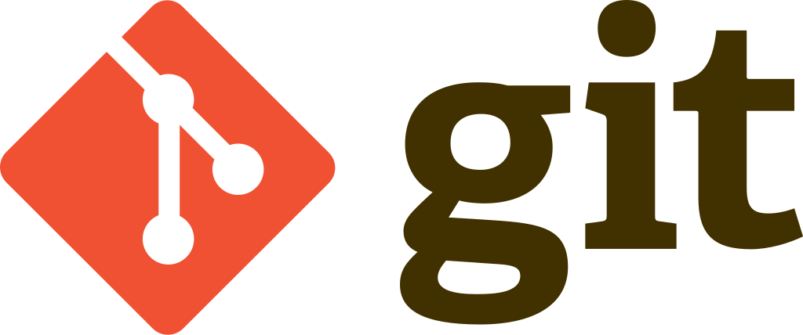

 

url del curso:
https://www.youtube.com/watch?v=3GymExBkKjE

# Definiciones iniciales

## Git
Es un sistema de control de versiones distribuido (administra las distintas versiones de un programa).
Un sistema de control de versiones permite llevar un historial de todos los cambios que existan en un proyecto, los cuales pueden ser accedidos en cualquier momento.

## Repositorios
Un repositorio es una carpeta mejorada. Es una carpeta de git donde vas guardando tu progreso y te permite en cualquier momento acceder a versiones anteriores de ese mismo archivo.
¡OJO! No poner espacios en los nombres de repositorios.

## Commit
Forma de guardar el progreso de uno o varios archivos del repositorio.
Con cada commit que haga se debe guardar un mensaje especificando cuales fueron los cambios que se realizaron

## Push
Para pasar mi repositorio local, por ejemplo a github, o de hacer que un commit quede vivo en el repositorio

## Comandos basicos
A la hora de trabajar con Git, se puede utilizar tanto la terminal (PowerShell / Bash) como alguna interfaz grafica (Github Desktop / Sourcetree, etc).
Si bien al inicio utiizar una interfaz grafica pareceria ser la opcion mas conveniente (facilidad de uso para el usuario), es recomendable aprender los comandos y trabajar desde la terminal, ya que las interfaces no suelen ofrecer la totalidad de funciones que se pueden encontrar mediante terminal.

A continuacion se presentan algunos comandos basicos de terminal como para comenzar a familiarizarse. Todos los comandos que se presentan en este documento funcionan correctamente en Git Bash (la mayoria tambien funcionan en Powershell). Ambas se pueden ejecutar desde VS Code, abriendo la terminal correspondiente

```Bash
git --version       # versión instalada de git
ls                  # muestra todas las carpetas del path donde me encuentre
cd desktop          # se mueve al escritorio
cd ..               # va una carpeta hacia atrás
pwd                 # va una carpeta hacia atrás
mkdir “HelloGit”    # creo una nueva carpeta en el path
cd HelloGit         # cambio al path
code .              # abre VSCode sobre ese path
clear               # limpia la consola
```

## Configuración del usuario de Git
Como mínimo preciso usuario y mail -- genera el archivo .gitconfig
```Bash
git config --global user.name “Javier”
git config --global user.email “hola@hola.com”
```

## Comandos basicos de Git
Para establecer que cierta carpeta es un repositorio.
```Bash
git init          # Transforma la carpeta en repositorio
```
Este comando crea en el direcotio actual una carpeta oculta ".git", la cual es utilizada por git para identificar dicha carpeta como repositorio.

Por defecto te situa sobre la rama de inicio: "master". Para cambiar el nombre de una rama, basta con situarse en ella y  ejecutar:
```Bash
git branch -m main        # Cambia el nombre de la rama actual
```
A partir de ahora, la rama "main" sera la rama central de nuestro proyecto.

Ahora vamos a crear archivos de python, mediante el terminal.
Para ello utilizamos el comando "touch".
```Bash
touch hellogit.py        # en el path actual, crea el archivo hellogit.py
git status               # estado actual del repo: archivos nuevos / modificados
git add hellogit.py      # hace el stage (deja los cambios prontos para commitear)
git status               # ahora el status del repositorio cambio
git commit -m “Este es mi primer commit”
    # hago el commit con el comentario correspondiente
    # el commit viene hacer como un "guardar cambios"
```

## Checkout
Asumo que realice cambios sobre el código de hellogit2
```Bash
git status                  # ahora pone 'modified' indicando los archivos que tuvieron cambios
git checkout hellogit2.py   # vuelve a la foto que tenia en el commit anterior
```

## Log
Muestra la información de los commits
```Bash
git log --graph                             # trae el log pero mostrando las líneas de ramificación
git log --graph --pretty=oneline            # muestra los commits resumidos
git log --graph --decorate --all --oneline  # idem anterior pero con primeros caracteres del commit
```

## Alias
Para no tener que recordar todos los comandos de la ultima línea, puede crear un alias
```Bash
git config --global alias.tree “log --graph --decorate --all --oneline”
git tree
```
El alias es lo que queda guardado despues del ".".
Queda guardado en el archivo gitconfig

## Git Ignore
Se utiliza para decirle a Git los archivos que voy a querer excluir del repositorio.
En lugar de eliminarlos, los ignoro. Quedan en el repositorio pero no se les hace commit.

```Bash
touch .gitignore            # crea el .gitignore (se abre con cualquier editor de texto)
git status                  # ahora no trae los archivos a ignorar pero aparece el gitignore
git add .gitignore          # stageo el gitignore
git commit -m “Se añade el gitignore”
```

## Diff
Para ver los cambios que he hecho respecto del archivo comitteado
```Bash
git diff	# muestra el historial de cambios
```

## Reset
Cada commit queda guardado con un codigo hash que lo identifica.
Por ejemplo:
	• commit e1d7617aa2edde06f7733e5f9db2ac316feaf3f5
En cualquier momento puedo volver atras seleccionando un commit en particular.

```Bash
git reset 44e84e                # vuelve a instancia 44e84e (mantiene archivos posteriores)
git reset --hard 44e84e         # vuelvo a instancia 44e84e (borra archivos posteriores)
```

## Tags
Etiquetar commits para referenciar puntos importantes del desarrollo

```Bash
git tag clase_1                         # le agrega el tag al último commit
git add .
git status
git commit -m “Commit con tag”
git tag nueva_etq						# trae todos los tags del repositorio
git checkout tags/clase_1				# para ir a la instancia “clase1” del repositorio
```

## Historial
```Bash
git reflog     # historial completo de interacciones en el repositorio
```

## Ramas (Branches)
Creación de ramas adicionales permite trabajar con los desarrollos de manera independiente.
Imaginar que cada rama se encarga de un aspecto especifico del programa. Por ejemplo, una rama
hace la pantalla de login, otra rama contiene los desarrollos de estado de cuenta, etc.
En este caso, creo uaQuiero crear una rama para hacer la pantalla de login de los usuarios

```Bash
git branch login        # creo una rama llamada login
git switch login        # me muevo a la rama login para trabajar sobre ella
git checkout login      # otra forma de cambiarme de rama
```

Estando ubicado en la rama nueva, creo un archivo llamado login.py que tendrá todo el código
```Bash
touch login.py
git add .
git commit -m “se agrega la lógica del login”
```

## Merge
Aun en mi rama `login`, otro equipo hizo cambios en `main`, por lo que quiero tener en mi rama `login` los ultimos cambios.
Para ello, aun en `login`, hago un merge con la rama `main`.
```Bash
git merge main
```
 
## Conflictos
Sucede al hacer merge entre dos ramas, cuando por ejemplo, ambas modificaron el mismo archivo. En ese caso habría que decidir cual de los dos archivos es el bueno, y luego proceder con el merge.

## Stash
Situación: Estoy trabajando en un rama, y me piden que trabaje sobre otra que tiene un error urgente a corregir. El tema es que el código de mi rama actual está incompleto o sin chequear, por lo que no quiero hacerle commit aún. Por la logica de git, no puedo cambiar de rama si tengo desarrollos sin comittear.
Por estos casos, el comando stash es ideal porque permite guardar los cambios temporalmente, sin la necesidad de hacer commit.
```Bash
git stash                   # commit local que solo queda reflejado en mi maquina local (solo lo veo yo)
git switch main             # pude cambiar de rama
git switch login            # vuelvo a la rama login (al estado sin los ultimos cambios)
git stash list              # listado de stash disponibles
git stash show -p stash@{0} # muestra el contenido de un stash
git stash apply stash@{1}   # selecciono un stash en particular, sin borrarlo
git stash pop stash@{1}		# selecciono un stash en particular, y lo borra
git stash drop stash@{0}    # elimina un stash en particular
git stash clear				# borra todos los stash
git add .
git commit -m “login v2”    # hago los commit con los cambios
```

## Reintegracion de ramas
Cuando termino el desarrollo de un rama y quiero impactarlo sobre la rama principal, tengo dos opciones.
1. Me paso a la rama main, y luego hago un merge (igual que lo visto previamente)
```Bash
git switch main
git merge login                # traigo a la rama main, los desarrollos de login
git status
git add .
git commit -m “desarrollo de login”
```
Este mecanismo puede ser peligroso porque estoy impactando los cambios sobre la rama main (rama principal), sin haber hecho ningun tipo de chequeo.

2. Mediante Pull Request (lo vemos mas adelante)
El `Pull Request (PR)` implica que el desarrollador de la rama nueva, le solicita al administrador del repositorio, la habilitacion para impactar los cambios de dicha rama, sobre la rama sobre la que se hace el PR.
Antes de aprobar los cambios, el administrador revisa el codigo y aprueba/desaprueba la solicitud.
Lo vemos mas adelante.

## Eliminacion de ramas
Una vez la rama terminó su desarrollo y se metió en el main, puedo borrarla.
```Bash
git branch -d login        # dropeo la rama login
git switch login           # no puedo ir a una rama eliminada
git tree
``` 

## Github
Plataforma remota, en la nube, que por debajo utiliza git. Permite que nuestro código este subido a un servidor remoto con el que más personas puedan interactuar.

En Repositorios -- New -- Creas los nuevos repositorios.
Ahí le asignas nombres, descripción, publico/privado, readme, gitignore, etc.

Hacer un repositorio cuyo nombre sea igual al nombre de usuario, permite modificar el Overview del perfil del usuario.

## Remote
Hace la conexión del repositorio local con un repositorio en la nube de github.
Básicamente lo que quiero ahora es llevar mi repositorio local a github.
En la consola de git escribimos:
```Bash
git remote add origin git@github.com:JNunez/hello-git
```

En Github Desktop esto se puede hacer con:
File -- Add Local Repository -- Seleccionar el repositorio que quiero subir -- Elegir el nombre que va a tener el repositorio y si va a ser publico o privado

## Push
Una vez tengo conectados mi repositorio local con el repositorio en Github, ahora lo que voy a querer es que los cambios que haya impactado en el repo local, se suban a github. Para ello se utiliza el comando push.
```Bash
git push # tambien puede incluir: -u origin main
```

Imaginar ahora lo siguiente:
   * Sobre el archivo "test.py" hago un cambio en mi repositorio de Github
   * Dias mas tarde, sobre el mismo archivo "test.py", pero en mi repo local, hago desarrollos.
   * Nunca sincronize los cambios del repositorio de Github en el repo local.
En este caso, al querer hacer el push va a generarse un conflicto, porque hay dos instancias distintas del mismo archivo. En este caso tengo cuatro opciones:
1.  Hacer un push forzoso de mi rama local hacia Github (perdiendo los cambios en Github)
```Bash
git push --force origin <nombre_rama>
```
2. Hacer un pull forzoso desde Github a mi rama local (perdiendo los cambios en mi rama local)
```Bash
git fetch origin
git reset --hard origin/<nombre_rama>
```
3. Hacer un merge entre ambos escenarios (mantiene ramificaciones)
```Bash
git fetch origin
git merge origin/<nombre_rama>
git status
git push origin main
```
4. Hacer un rebase entre ambos escenarios (unifica ramificaciones)
```Bash
git fetch origin
git rebase origin/<nombre_rama>
git status
git push origin main
```


## Fetch
Descargar desde Github el historial de cambios al repositorio local, pero sin descargarse los cambios.
```Bash
git fetch # descarga el historial de cambios
git log
```

## Pull
Descarga desde Github el historial de cambios al repositorio local, y también descarga los cambios.
Puede suceder que hubiera habido cambios en el repositorio de github, por ejemplo correcciones de código o que otro colaborador haya pusheado archivos. En ese caso exisitiría una diferencia entre mi repositorio local y el de github.
```Bash
git pull -u origin mail
```

## Clone
Si quiero obtener una copia sincronizada del repositorio de Github.
Primero crear una carpeta vacía donde voy a alojar el repositorio.
Desde Github ir al repositorio -- Code -- En Clone, copiar la url para realizar la clonación (debe terminar el .git)
```Bash
git clone git@github.....git
```
Una vez tengo el repositorio clonado, puedo empezar a trabajar sobre el, haciendo los commit/push/etc correspondientes.


## Fork
Sirve para clonar repositorios ajenos.
Este comando surge porque no tengo permiso de escritura sobre repositorios de otros usuarios.
Haciendo un fork, genero la clonación de dicho repo y puedo trabajar sobre el de la manera que desee.
En github, elijo el repositorio que quiera Forkear, y voy al botón Fork -- Me pide que complete datos (igual que si creara el repo desde cero) -- Crear
Una vez hecho esto, recordar hacer el clone del nuevo repo forkeado a la pc local.
Luego de hecho el fork, trabajo sobre el código hasta terminarlo.
En este punto me gustaría que el repositorio original (el ajeno) tuviera mis modificaciones ya que éstas le agregan valor. Para ello, dentro de github Github:
   * --> Ir al repositorio
   * --> Contribute
   * --> Click en Open Pull Request
   * --> Añadir Titulo y Comentario
   * --> Create Pull Request.
Ahora solo resta esperar si el dueño del repositorio autoriza los cambios o no (la aprobacion implica aprobarlos y luego mergearlos)

## Sync
Luego de hacer el fork sobre un repositorio ajeno, puedo querer que el repositorio forkeado y el original estén sincronizados, de forma que el repo de mi carpeta siempre tenga el ultimo estado del repo original.
Al lado de “Contribute”, está el botón “Sync Fork”.
En “Compare” puedo ver las diferencias entre ambos repos.
En “Update Branch” actualizo mi repo con los cambios del repo original.
 
## Git Flow
```Bash
git brew install git flow				# para utilizar git flow desde la consola
git flow init					# inicializa git flow en ese repositorio
						# nombrar las ramas de features, release, hotfix, y support

git flow feature start 2auth			# quiero crear un feature para doble factor de autenticación
git flow feature finish 2auth			# luego de finalizado el desarrollo el auth, lo finalizo, y automáticamente hace el merge con develop

git flow release start 1.0			# lanzo la versión 1.0 del código
git flow release finish 1.0
 -->
```

## Cherry-Pick
Comando que te permite ir hacia un commit en concreto, y traerlo a la rama que quiera (no es muy utilizado porque es para algo muy concreto)
```Bash
git cherry-pick e4dd475			# e4dd475 es el id del commit que quiero traer
```

## Rebase
Sirve para traer una rama, a un punto concreto (es casi como modificar el historial de commit).
Utilizarlo es muy delicdado.
	git rebase sfsd
	git rebase -i					# interactivo (paso a paso)


SEGUIR DESDES 3.53.50
